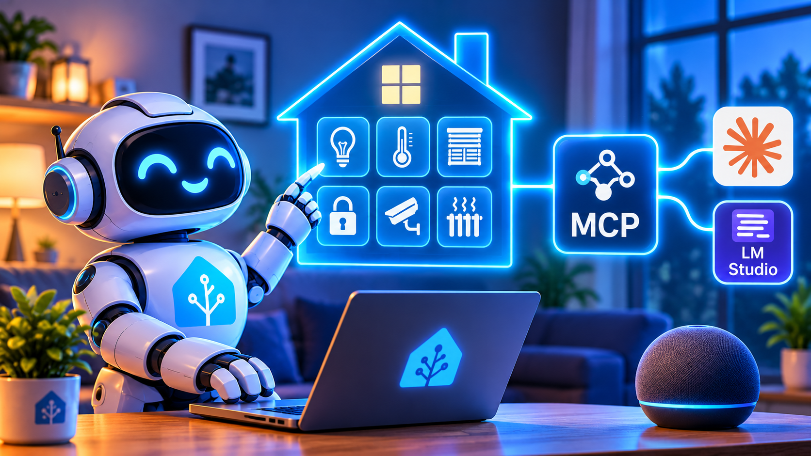

<div align="center">
  
</div>

# Home Assistant MCP Server (beta)

> **This is a beta, version 0.2.1.** It works well against a real Home Assistant 2026.10 instance, but some write paths have not been tried on real hardware (see [What has and has not been tested](#what-has-and-has-not-been-tested)). It starts in read only mode, so nothing can be changed until you decide otherwise. Keep backups of your Home Assistant, and report anything odd as a GitHub issue.

A Model Context Protocol (MCP) server that lets an AI assistant look at your Home Assistant and, if you allow it, change it. **It starts in read only mode with 42 tools.** The number of tools depends on the mode you choose: 42 (read only), 43 (control only), 67 (edit only) and 68 (full access). The optional raw API tools add 2 more in Modes A, B and C, or 4 more in Mode D, and the optional Supervisor tools add up to 6 more, for a maximum of 78. Together they cover entities, areas, history, automations, scripts, helpers, dashboards, scenes, blueprints, integrations, repairs, diagnostics and a raw API escape hatch.

It works with any MCP client that can launch a local program over stdio. This guide covers two of them in detail: **Claude Desktop** and **LM Studio**.

**Tested with:** Home Assistant 2026.10.1 (Container install, Docker). Other versions are untested, so older releases may behave differently.

## Quick start

1. **Get your Home Assistant address and a token.** See [Before you start](#before-you-start).
2. **Install it.** For Claude Desktop, drag the `.mcpb` file into Settings, then Extensions ([Set up in Claude Desktop](#set-up-in-claude-desktop)). For LM Studio, unpack the file and edit `mcp.json` ([Set up in LM Studio](#set-up-in-lm-studio)).
3. **Enter your address and token, and leave everything else alone.** You start in Mode A, read only. The assistant can look at your home but cannot change anything.
4. **Try it.** Ask "Give me an overview of the house."
5. **When you want it to do things, choose a mode.** See [Choose how much access to give](#choose-how-much-access-to-give).
6. **Protect your important entities first.** See [Protect specific entities](#protect-specific-entities).

## Contents

1. [What it can do](#what-it-can-do)
2. [Choose how much access to give](#choose-how-much-access-to-give)
3. [Protect specific entities](#protect-specific-entities)
4. [Before you start](#before-you-start)
5. [Set up in Claude Desktop](#set-up-in-claude-desktop)
6. [Set up in LM Studio](#set-up-in-lm-studio)
7. [Settings reference](#settings-reference)
8. [How the settings work together](#how-the-settings-work-together)
9. [Raw API tools: what they do and why they are off by default](#raw-api-tools-what-they-do-and-why-they-are-off-by-default)
10. [When something is not allowed](#when-something-is-not-allowed)
11. [How to use it](#how-to-use-it)
12. [The tools, one by one](#the-tools-one-by-one)
13. [Safety model](#safety-model)
14. [What has and has not been tested](#what-has-and-has-not-been-tested)
15. [Build from source](#build-from-source)
16. [Troubleshooting](#troubleshooting)
17. [Project layout](#project-layout)
18. [Licence](#licence)

## What it can do

Roughly, in plain English:

* **Look around.** Find entities, list rooms, see what is in a room, read history and the logbook, run templates.
* **Understand your home.** Get an overview, find broken things (unavailable devices, flat batteries, failed integrations, repairs), work out why something changed, read energy statistics, calendars, to-do lists, weather forecasts and camera snapshots.
* **Control things.** Call any Home Assistant service. Dangerous ones (locks, alarms, heating, garage doors, whole area commands) need an explicit two step approval.
* **Manage automations and scripts.** List, read, validate, create, update, delete, reload, and debug failed runs using traces.
* **Manage helpers, scenes, dashboards, blueprints, areas, floors, labels, devices, entities and zones.**
* **Manage integrations and repairs.** Reload, rename, enable, disable and remove config entries, and run setup flows step by step.
* **Maintain the system.** Check the configuration, read logs, restart.
* **Reach anything else** through the raw REST and WebSocket tools.
* **Undo mistakes.** Config changes are validated, backed up, and can be rolled back.

Which of these the assistant can actually do depends on the mode you choose. By default it can only look. See [Choose how much access to give](#choose-how-much-access-to-give).

## Choose how much access to give

You do not have to decide this straight away. If you change nothing, you get Mode A, which can only look. The server has four access modes, and the rest of this guide refers to them by letter. You choose a mode with two settings. In Claude Desktop they are two tick boxes. In LM Studio and other clients they are two values in the config file. Both are off by default, and that gives you Mode A, which can only look.

### The two access settings

| Claude Desktop tick box | LM Studio setting | Default | What it allows |
| --- | --- | --- | --- |
| Allow controlling devices | `HA_ALLOW_CONTROL` | Off | The assistant can operate devices, such as lights, plugs, blinds and media players |
| Allow editing setup | `HA_ALLOW_EDIT` | Off | The assistant can change how Home Assistant is set up, such as automations, scripts, dashboards and settings |

Each setting adds its own ability, so neither one makes the other pointless. The Claude Desktop form can only show tick boxes, because the extension format has no drop down list, so the four modes are made from these two boxes.

### The four modes

This table shows which boxes give which mode.

| Mode | Name | Allow controlling devices | Allow editing setup | LM Studio settings to add |
| --- | --- | --- | --- | --- |
| A | Read only | Unticked | Unticked | None. Leave both out. |
| B | Control only | Ticked | Unticked | `"HA_ALLOW_CONTROL": "true"` |
| C | Edit only | Unticked | Ticked | `"HA_ALLOW_EDIT": "true"` |
| D | Full access | Ticked | Ticked | Both of the above |

This table shows what each mode can do. "Yes, with approval" means a preview and your confirmation are needed every time. See [What happens when you ask for a change](#what-happens-when-you-ask-for-a-change).

| What the assistant can do | Mode A | Mode B | Mode C | Mode D |
| --- | --- | --- | --- | --- |
| Look at everything, including history, logs and statistics | Yes | Yes | Yes | Yes |
| Operate everyday devices: lights, plugs, fans, blinds, media players and helpers | No | Yes | No | Yes |
| Operate locks, alarms, heating and any other service | No | No | No | Yes, with approval |
| Create, edit or delete automations, scripts, scenes and helpers | No | No | Yes, with approval | Yes, with approval |
| Change dashboards, areas, labels, devices and integrations | No | No | Yes, with approval | Yes, with approval |
| Restart or stop Home Assistant, or restore a backup | No | No | Yes, with approval | Yes, with approval |
| Use the raw API write tools (only if you switch them on) | No | No | No | Yes, with approval |
| Number of tools | 42 | 43 | 67 | 68 |
| Number of tools with the Raw API tools switched on | 44 | 45 | 69 | 72 |

The optional Supervisor tools add up to 6 more tools in any mode. Their read tools work in every mode, and their write tools (add-on management and Home Assistant backups) need Allow editing setup.

### Which mode should I choose?

| I want to | Choose |
| --- | --- |
| Look around and ask questions about my home | Mode A |
| Have the assistant run my lights, plugs, blinds and music | Mode B |
| Build or fix automations, scripts and dashboards without the assistant being able to operate any device | Mode C |
| Do both in one session, or control locks, alarms and heating | Mode D, for a short job, with a backup |
| Use a local model such as LM Studio | Mode A, or Mode B at most |

Start with Mode A, which is what you get if you change nothing. Move up one step at a time.

### Everything starts locked down

Every default is the most restrictive choice, so you have to open things up yourself.

| Setting | Default | What opening it up means |
| --- | --- | --- |
| Allow controlling devices (`HA_ALLOW_CONTROL`) | Off | Gives Mode B, or Mode D together with the next setting |
| Allow editing setup (`HA_ALLOW_EDIT`) | Off | Gives Mode C, or Mode D together with the setting above |
| Require an approval prompt (`HA_REQUIRE_APPROVAL_PROMPT`) | On | Switching it off means the preview and confirm steps replace a human prompt |
| Raw API tools (`HA_ENABLE_RAW`) | Off | Switching it on adds the raw tools |
| Supervisor tools (`HA_ENABLE_SUPERVISOR`) | Off | Switching it on adds the add-on and host tools |
| Allow self signed certificates (`HA_INSECURE_TLS`) | Off | Switch it on only for an `https://` address with a self-signed certificate |
| Never touch entities and Extra high risk entities | Empty | Fill them in to protect or flag specific entities |

The dashboards and insight tool groups are on by default. They are not a risk on their own, because they only offer read tools unless Allow editing setup is ticked.

### Mode A: Read only

* **Best for:** exploring, and any use with a local model.
* **What it can do:** look at everything. It can find entities, read history, logs and statistics, check for problems and read automations and their traces.
* **What it cannot do:** change anything. Every tool that could change something is not registered, so the assistant cannot call it because it does not exist.
* **How to turn it on:** leave both boxes unticked. This is the default.
* **Tools:** 42, or 44 with the Raw API tools on.

### Mode B: Control only

* **Best for:** everyday use by someone who wants the assistant to run their devices.
* **What it can do:** everything in Mode A, plus operate everyday devices. That covers more than switching on and off. It includes brightness and colour, fan speed, opening and closing blinds, the volume and track on a media player, starting a vacuum, setting a helper's value and activating a scene. These are the allowed service domains: `light`, `switch`, `fan`, `cover`, `media_player`, `humidifier`, `vacuum`, `remote`, `button`, `number`, `select`, `scene` (activating only), `input_boolean`, `input_button`, `input_number` and `input_select` (values only).
* **What it cannot do:**
  * Operate locks, alarm panels, heating and cooling, water heaters, valves, scripts, automations or notifications.
  * Change any setup. The tools for automations, scripts, helpers, dashboards, settings and restarting do not exist in this mode.
  * Use services that change how something is set up (`reload`, `create`, `delete`, `apply`, `remove` and `set_options`).
  * Target devices by label. Name the entities, or use an area.
  * Use the generic `homeassistant.turn_on`, `turn_off` and `toggle` on anything except named entities in the allowed domains.
  * Anything outside these limits is refused outright, with no approval route.
* **Approval:** calls that are allowed but risky, such as switching a washing machine plug or a whole area at once, still need the preview and confirm steps. The never touch list always applies. Blinds and covers are allowed, so put garage doors and gates on the never touch list.
* **How to turn it on:** tick Allow controlling devices only.
* **Tools:** 43, or 45 with the Raw API tools on.

### Mode C: Edit only

* **Best for:** building automations, scripts and dashboards with no chance of the assistant operating a device itself.
* **What it can do:** everything in Mode A, plus change how Home Assistant is set up. Every change needs approval and, where possible, an automatic backup first. It covers these tools:
  * Automations and scripts: `save_automation`, `delete_automation`, `reload_automations`, `save_script`, `delete_script` and `reload_scripts`.
  * Helpers: `create_helper`, `update_helper` and `delete_helper`.
  * Dashboards, registries, scenes, blueprints and integrations: `save_dashboard`, `save_dashboard_view`, `create_dashboard`, `delete_dashboard`, `delete_dashboard_config`, `manage_registry` (areas, floors, labels, devices, entities and zones), `save_scene`, `delete_scene`, `import_blueprint`, `delete_blueprint`, `manage_config_entry`, `run_config_flow` and `ignore_repair`. These belong to the "Dashboards, registries, scenes, blueprints and integrations" tool group. If you switch that group off, they disappear in every mode.
  * System: `restart_home_assistant`, `stop_home_assistant` and `restore_backup`.
  * Supervisor tools, only if you also switch those on: `create_ha_backup` and `manage_addon`.
* **What it cannot do:** operate devices. The `call_service` tool is not registered, and the raw write tools stay off.
* **Take care:** automations and scripts that you or the assistant create can operate devices when they run. Put anything critical on the never touch list.
* **How to turn it on:** tick Allow editing setup only.
* **Tools:** 67, or 69 with the Raw API tools on.

### Mode D: Full access

* **Best for:** a short, specific job that needs both abilities. Take a Home Assistant backup first, and go back to a lower mode when you have finished.
* **What it can do:** everything in Modes B and C. The `call_service` tool is no longer limited to everyday devices, so locks, alarms, heating and any other service are possible. The raw write tools are also available if you have switched on the Raw API tools.
* **Safeguards:** every call still goes through the risk assessment, the never touch list and the preview and confirm steps.
* **How to turn it on:** tick both boxes. Read [Turning on Mode D](#turning-on-mode-d-be-careful) first if you use LM Studio.
* **Tools:** 68, or 72 with the Raw API tools on. For every tool the server has, see [Getting everything: all 78 tools](#getting-everything-all-78-tools).

### Getting everything: all 78 tools

Mode D gives full control and full editing, but the raw API tools and the Supervisor tools are separate switches that are off by default. For the complete set of 78 tools, switch on all four of these:

| Setting | Claude Desktop | LM Studio | Needed value | Default |
| --- | --- | --- | --- | --- |
| Allow controlling devices | Tick the box | `HA_ALLOW_CONTROL` | `"true"` | Off |
| Allow editing setup | Tick the box | `HA_ALLOW_EDIT` | `"true"` | Off |
| Raw API tools | Tick the box | `HA_ENABLE_RAW` | `"true"` | Off |
| Supervisor tools | Tick the box | `HA_ENABLE_SUPERVISOR` | `"true"` | Off |

Two more settings must stay on, and they are on by default: Dashboards, registries, scenes, blueprints and integrations (`HA_ENABLE_CONFIG`), and Insight tools (`HA_ENABLE_INSIGHTS`). Switching either one off removes tools. With the dashboards group off, for example, the full set drops from 78 to 56.

This is how the tool count builds up:

| Settings switched on | Tools |
| --- | --- |
| Both access boxes (Mode D) | 68 |
| Mode D and Raw API tools | 72 |
| Mode D and Supervisor tools | 74 |
| Mode D, Raw API tools and Supervisor tools | 78 |

In LM Studio the `env` block for everything looks like this:

```json
"env": {
  "HA_URL": "http://192.168.1.50:8123",
  "HA_TOKEN": "eyJhbGciOi...your_long_token...",
  "HA_ALLOW_CONTROL": "true",
  "HA_ALLOW_EDIT": "true",
  "HA_ENABLE_RAW": "true",
  "HA_ENABLE_SUPERVISOR": "true"
}
```

Things to know before you do this:

* **Supervisor tools only work on Home Assistant OS or Supervised.** On a Docker or Core install they still count towards the 78, but they answer that no Supervisor is available.
* **The raw write tools have no automatic backup.** Read [Raw API tools](#raw-api-tools-what-they-do-and-why-they-are-off-by-default) first.
* **The approval prompt is still on by default.** If your client cannot show prompts, risky actions are refused. Switching `HA_REQUIRE_APPROVAL_PROMPT` off is explained in [Turning on Mode D](#turning-on-mode-d-be-careful).
* **Your never touch and extra high risk lists still apply.** Everything is available, but not everything is allowed. Anything on the never touch list stays blocked.
* **This is not recommended for local models.** See the [warning for local models](#a-serious-warning-for-lm-studio-and-other-local-models).

### Changing the mode later

Change the two settings, restart, and start a new chat. The exact steps are in [Changing settings later](#changing-settings-later) for Claude Desktop and in [Switching between modes later](#switching-between-modes-later) for LM Studio. After every change, count the tools in a new chat to confirm the mode. You should see 42, 43, 67 or 68. If the Raw API tools are on, add 2 for Modes A, B and C, or 4 for Mode D.

## Protect specific entities

Two optional settings let you protect particular devices. They only matter once your mode can change things (Modes B, C and D), and they are the best protection you have, so set them up before you move beyond Mode A.

An entity is one thing in Home Assistant, such as a light, a lock or a switch. Every entity has an entity ID, which is a type, a dot and a name, for example `light.kitchen` or `lock.front_door`. Both settings work on entity IDs.

### The two settings

| | Never touch entities | Extra high risk entities |
| --- | --- | --- |
| Claude Desktop box | Never touch entities | Extra high risk entities |
| LM Studio setting | `HA_NEVER_TOUCH` | `HA_HIGH_RISK_ENTITIES` |
| Default | Empty | Empty |
| What happens | The assistant can never change it, even if you approve | The assistant can change it, but only after a preview, your confirmation and the approval prompt |
| Can the assistant still look at it? | Yes | Yes |
| Use it for | Things you could not bear to have changed, such as locks, alarms and garage doors | Things you are happy to change but want to check first, such as a workshop socket or a pool pump |

Some detail on each:

* **Never touch** is an absolute block. The call is refused straight away, and there is no way to approve it. It also catches indirect changes. An area command that includes a protected entity is refused. So is a device target that includes one. Automations, scripts and scenes that use a protected entity cannot be saved.
* **Extra high risk** adds to the built in rules and never loosens them. Locks, alarms, heating, garage doors and anything with an appliance style name already need approval. This setting adds your own entities to that group. In Mode B it makes those calls need the preview and confirm steps. It does not block them.
* These settings only limit what this server can do. They do not change Home Assistant itself, so existing automations carry on running as normal.
* In Mode A nothing can be changed, so neither setting has any effect. It does no harm to fill them in ahead of time.

### How to write the entries

Write entity IDs separated by commas. A `*` matches any run of characters. A `?` matches exactly one character. Capital letters do not matter, and spaces after the commas are fine. The whole entity ID has to match, not just part of it.

| Entry | What it matches |
| --- | --- |
| `lock.front_door` | Exactly that one entity |
| `lock.*` | Every lock |
| `alarm_control_panel.*` | Every alarm panel |
| `cover.garage_*` | Every cover whose name starts with `garage_`, such as `cover.garage_door` |
| `switch.*_heater` | Every switch whose name ends with `_heater`, such as `switch.office_heater` |
| `light.hall_?` | `light.hall_1` and `light.hall_2`, but not `light.hall_10` |
| `*` | Everything. Never use this. |

To find an entity ID, open Home Assistant, go to Settings, then Devices and services, then Entities. Each entity has an Entity ID. If you do not see that column, use the table's column settings to show it, or click an entity and open its settings to see the ID. You can also ask the assistant, for example "Find my garage door".

### How to enter them

In Claude Desktop, type or paste the entries into the box, separated by commas:

```
lock.*, alarm_control_panel.*, cover.garage_*, cover.gate_*
```

In LM Studio, add one line to the `env` block. It is a single string in double quotes, with commas between the entries. Do not use a JSON array.

```json
"HA_NEVER_TOUCH": "lock.*,alarm_control_panel.*,cover.garage_*,cover.gate_*",
"HA_HIGH_RISK_ENTITIES": "switch.workshop_*,switch.washing_machine"
```

Change the examples to match your own entity IDs. A sensible starting point is to put locks, alarm panels, garage doors and gates on the never touch list, and any appliance or workshop socket you want to double check on the extra high risk list.

LM Studio users can also set `HA_HIGH_RISK_DOMAINS`, which makes every entity of a whole type high risk, for example `"vacuum,media_player"`. It is not in the Claude Desktop form.

### What it looks like in use

Say `cover.garage_*` is on the never touch list and you are in Mode B. You ask "Open the garage door." The assistant tries, the server refuses, and the assistant tells you the entity is on the never touch list, names the setting (Never touch entities, or `HA_NEVER_TOUCH`) and says you would have to remove it from the list to allow the change.

Say `switch.workshop_*` is on the extra high risk list. You ask "Turn on the workshop heater." The assistant first shows you a plan and asks whether to go ahead. After you say yes, and accept the approval prompt, it runs.

### Check that it works

1. Add a harmless entity to the never touch list, such as `light.desk_lamp`.
2. Restart Claude Desktop (or switch the LM Studio server off and on) and start a new chat.
3. In Mode B or D, ask the assistant to turn the lamp on. It should refuse and name the setting.
4. Remove the entry and restart again, so you can use the lamp normally.

You can also ask "Which entities are protected from changes?" The assistant is told which patterns are protected when it connects, so it should be able to list them.

### Common mistakes

* **Using the name instead of the entity ID.** "Garage Door" does nothing. Use the ID, such as `cover.garage_door`.
* **Getting the type wrong.** The type is singular. Write `light.*`, not `lights.*`.
* **Using a JSON array in LM Studio.** Use one string with commas.
* **Forgetting to restart.** Settings are read when the server starts, and old chats keep the old settings. Restart, then start a new chat.
* **Protecting too much.** `light.*` on the never touch list stops the assistant switching any light at all.

## Before you start

You need two things from Home Assistant, whichever client you use.

**1. Your Home Assistant address.** This is the address you type into a browser to open Home Assistant, including the port. For example `http://192.168.1.50:8123` or `http://homeassistant.local:8123`. If `homeassistant.local` does not work from your computer, use the IP address instead.

**2. A long-lived access token.** Make one just for this server, so you can revoke it separately without affecting anything else.

1. In Home Assistant, click your name at the bottom left of the sidebar to open your profile.
2. Open the **Security** tab.
3. Scroll to the very bottom, to **Long-lived access tokens**, and click **Create token**.
4. Name it something like `MCP server`.
5. **Copy the token immediately.** Home Assistant only shows it once.

Treat the token like a password. Anyone who has it can control your Home Assistant. Never paste it into a public place, including screenshots, forum posts and GitHub issues.

You also need to have chosen your mode (A, B, C or D) in [Choose how much access to give](#choose-how-much-access-to-give).

## Set up in Claude Desktop

Claude Desktop reads the `.mcpb` file for you, so there is nothing to unpack.

### Step 1: Install the extension

1. Download `home-assistant-mcp-0.2.1.mcpb` from the GitHub release page.
2. Open Claude Desktop and go to Settings, then Extensions.
3. Drag the file in, or double click it in Finder or File Explorer.
4. The extension appears as **Home Assistant (full control)**. Click **Install**.

### Step 2: Fill in the settings form

The form has 13 settings. Fill it in three parts. Every setting is explained in the [Settings reference](#settings-reference).

**Part 1: the two required settings**

| Setting in the form | What to enter |
| --- | --- |
| Home Assistant URL | Your address, for example `http://192.168.1.50:8123` |
| Long-lived access token | Your token |

**Part 2: choose your mode**

The two access settings, **Allow controlling devices** and **Allow editing setup**, are the only ones that decide the mode. Both are unticked by default, which gives Mode A. If you are not sure, leave both unticked. You can change them later. See [Choose how much access to give](#choose-how-much-access-to-give).

| Mode | Allow controlling devices | Allow editing setup |
| --- | --- | --- |
| A: Read only (the default) | Unticked | Unticked |
| B: Control only | Ticked | Unticked |
| C: Edit only | Unticked | Ticked |
| D: Full access | Ticked | Ticked |

**Part 3: everything else (optional, and the same in every mode)**

These settings have safe defaults and do not depend on the mode. Leave them as they are unless the last column describes your situation.

| Setting in the form | Default | Change it only if |
| --- | --- | --- |
| Allow self signed certificates | Off | Your address starts with `https://` and uses a self-signed certificate |
| Extra high risk entities | Empty | You want certain entities to always need approval before they are changed. See [Protect specific entities](#protect-specific-entities). |
| Never touch entities | Empty | You want certain entities to never be changed, such as locks and garage doors. Optional, but recommended once you move beyond Mode A. See [Protect specific entities](#protect-specific-entities). |
| Require an approval prompt for high risk actions | On | Risky actions are refused because your client cannot show a prompt. Switching it off means the preview and confirm steps are then the only check. |
| Dashboards, registries, scenes, blueprints and integrations | On | You want to give the assistant fewer tools |
| Insight tools | On | You want to give the assistant fewer tools |
| Raw API tools | Off | You have a specific need. Read [Raw API tools](#raw-api-tools-what-they-do-and-why-they-are-off-by-default) first. |
| Supervisor tools | Off | You run Home Assistant OS or Supervised and want add-on and host tools. They do not work on Docker or Core installs. |
| Entities expected to be unavailable | Empty | Some devices are often switched off and you do not want them reported as problems |

### Step 3: Check it works

1. Make sure the extension is switched **Enabled**.
2. Start a new chat and ask: "Check you can reach Home Assistant."
3. If it does not work, look at the extension's log. The first line tells you which URL is in use and how long the token is (never the token itself). The second line ends with the mode that started, and says how many tools were registered: `READ ONLY mode` (42 tools), `CONTROL ONLY mode` (43 tools), `EDIT ONLY mode` (67 tools), or no mode label for full access (68 tools). These counts assume the Raw API tools are off, which is the default.

### Changing settings later

Open Claude Desktop, go to Settings, then Extensions, choose **Home Assistant (full control)** and open its settings (the button is usually labelled **Configure**). Change what you need and save. Then:

1. **Quit Claude Desktop completely and reopen it.** Closing the window is not enough, so use Quit (Cmd+Q on a Mac). The settings are handed to the server when it starts, and saving the form does not always restart it, so the old values can stay in use until the app is restarted.
2. **Start a new chat.** An existing chat keeps the tools and instructions it was given when it began. That is how MCP works. The list of tools, and the briefing that tells the assistant which mode is on, are fixed for the life of a chat. An old chat can therefore keep behaving as it did under the old settings even after the server has changed. Chats started after the restart use the new settings.

You can check that the new settings took effect by counting the tools in a new chat: 42, 43, 67 or 68 (if the Raw API tools are on, add 2 for Modes A, B and C, or 4 for Mode D).

## Set up in LM Studio

LM Studio (version 0.3.17 or later) can run local MCP servers, but it cannot open an `.mcpb` file. You unpack ("explode") the file into a folder, then point LM Studio at the server inside. This is one continuous set of steps, so follow them in order.

### A serious warning for LM Studio and other local models

The safeguards in this server (preview first, single use plan tokens, the never touch list and backups) are good, but they rely on the model following instructions and on the client showing you what is going on. Claude is trained to respect those instructions. Many local models are not reliable at this. They can misread a plan, repeat a confirmation call on their own, invent entity names, or get talked into things by text they find inside your Home Assistant, such as an entity name, a calendar entry or a log line.

If you use this with LM Studio or any local model:

* Use Mode A. Treat it as the normal way to run it. If you want it to operate lights and plugs, use Mode B, which still blocks every change to automations, scripts and settings.
* If you really must use Mode C or D, be very careful. Do it for a short, specific task, then switch back.
* Put anything you could not bear to have changed on the never touch list (`HA_NEVER_TOUCH`), for example `lock.*`, `alarm_control_panel.*` and `cover.garage_*`.
* `HA_REQUIRE_APPROVAL_PROMPT` is on by default. If your client does not support MCP approval prompts, which LM Studio may not, high risk actions are refused. That is the safe outcome. Do not switch it off to fix that unless you understand that the model's own preview and confirm step is then the only check.
* Take a full Home Assistant backup first.
* Leave the raw API tools off. They are off by default (`HA_ENABLE_RAW` is not set), and they are the most powerful and least guarded part. See [Raw API tools: what they do and why they are off by default](#raw-api-tools-what-they-do-and-why-they-are-off-by-default).
* Never leave a model that can make changes running unattended.

Whatever you decide, start with Mode A.

### Step 1: Install Node.js and find where it lives

The server is a Node.js program. You need **Node.js 18.17 or newer**.

```bash
node --version
```

If you see `v18.17.0` or higher, you are fine. If the command is not found, or the version is older, install the current LTS version from https://nodejs.org and open a new terminal.

Now find out **exactly where Node lives**, because you will need that path in Step 7:

```bash
which node          # macOS and Linux
where node          # Windows
```

Write down the answer. Typical results are `/opt/homebrew/bin/node` (Mac with Homebrew), `/usr/local/bin/node`, or `C:\Program Files\nodejs\node.exe` (Windows).

### Step 2: Choose a permanent folder

Pick a folder where the server can live **permanently**. LM Studio will launch it from there every time, so do not use Downloads or the Desktop, and do not move it later without updating the config.

| System | Suggested folder |
| --- | --- |
| macOS | `/Users/yourname/mcp-servers/home-assistant` |
| Linux | `/home/yourname/mcp-servers/home-assistant` |
| Windows | `C:\mcp-servers\home-assistant` |

Create it:

```bash
# macOS and Linux
mkdir -p ~/mcp-servers/home-assistant
```

```powershell
# Windows PowerShell
mkdir C:\mcp-servers\home-assistant
```

### Step 3: Unpack the .mcpb into that folder

An `.mcpb` file is just a zip file with a different name. Inside is a `manifest.json` and the compiled server with all its dependencies. Download `home-assistant-mcp-0.2.1.mcpb` from the GitHub release page, then use **one** of these methods.

**Method A: the MCPB tool (any system with Node)**

```bash
npx @anthropic-ai/mcpb unpack ~/Downloads/home-assistant-mcp-0.2.1.mcpb ~/mcp-servers/home-assistant
```

**Method B: unzip (macOS and Linux)**

```bash
unzip ~/Downloads/home-assistant-mcp-0.2.1.mcpb -d ~/mcp-servers/home-assistant
```

**Method C: Windows**

1. Copy `home-assistant-mcp-0.2.1.mcpb` somewhere handy.
2. Rename it to `home-assistant-mcp-0.2.1.zip`. (If you cannot see the `.mcpb` ending, turn on "File name extensions" in the File Explorer View menu.)
3. Right click it, choose **Extract All**, and pick `C:\mcp-servers\home-assistant`.

### Step 4: Check the result

The folder should now contain these items directly inside it, not inside an extra subfolder:

```
home-assistant/
  manifest.json        what the bundle is and which settings it takes
  package.json
  README.md
  LICENSE
  dist/
    index.js           the server itself. This is the file LM Studio will run.
  node_modules/        the dependencies, already installed
```

If you see `home-assistant/home-assistant-mcp-0.2.1/dist/index.js` or similar, the files went into an extra folder. Either move them up one level, or just use the longer path later. What matters is that you know the full path to `dist/index.js`.

There is **no `npm install` step**. Everything is already in the bundle.

Work out the full path to `dist/index.js` and write it down. On a Mac or Linux you can print it with:

```bash
cd ~/mcp-servers/home-assistant
echo "$(pwd)/dist/index.js"
```

### Step 5: Try it from a terminal first

This checks that Node, the files, your address and your token all work, before LM Studio is involved. Use your own values from [Before you start](#before-you-start). You must run this **in the unpacked folder**, not in a source code checkout.

macOS and Linux:

```bash
cd ~/mcp-servers/home-assistant
HA_URL="http://192.168.1.50:8123" HA_TOKEN="paste_token_here" node dist/index.js
```

Windows PowerShell:

```powershell
cd C:\mcp-servers\home-assistant
$env:HA_URL="http://192.168.1.50:8123"
$env:HA_TOKEN="paste_token_here"
node dist/index.js
```

You should see lines like these (they appear on the error stream, which is normal):

```
[ha-mcp] using HA_URL=http://192.168.1.50:8123 (websocket ws://192.168.1.50:8123/api/websocket), token length 183
[ha-mcp] v0.2.1 ready with 42 tools for http://192.168.1.50:8123 (READ ONLY mode)
[ha-mcp] connected to Home Assistant 2026.10.1 (Home)
```

Then it sits there silently. That is correct: it is waiting for an MCP client to talk to it. Press **Ctrl+C** to stop it.

If the third line says `WARNING: cannot reach Home Assistant`, or you see a 401 error, fix that now using the [Troubleshooting](#troubleshooting) section before going on.

### Step 6: Open LM Studio's MCP config file

1. In LM Studio, open a chat.
2. Open the **Program** tab in the right hand sidebar (the plug icon).
3. Click **Install**, then **Edit mcp.json**.

This opens `mcp.json` in LM Studio's built in editor. The file lives here if you want to find it yourself:

| System | Location |
| --- | --- |
| macOS and Linux | `~/.lmstudio/mcp.json` |
| Windows | `%USERPROFILE%\.lmstudio\mcp.json` |

A fresh file contains `{ "mcpServers": {} }`.

### Step 7: Add the server for your chosen mode

Put an entry for the server inside `mcpServers`. Use the example for the mode you chose. The four examples differ only in the `HA_ALLOW_CONTROL`, `HA_ALLOW_EDIT` and `HA_REQUIRE_APPROVAL_PROMPT` lines. Every setting you leave out gets its safe default, so a config with neither `HA_ALLOW_CONTROL` nor `HA_ALLOW_EDIT` is Mode A. Replace the paths, address and token with your own.

**The paths in these examples are placeholders, not real paths.** Every path that contains `/EXAMPLE/CHANGE/ME/` must be replaced with a path from your own computer, or the server will not start. The same goes for the address and token. Do not copy them as they are.

| Line | What it is | What to put there |
| --- | --- | --- |
| `"command"` | The full path to the Node.js program on your computer | The answer you wrote down in Step 1 from `which node` (macOS and Linux) or `where node` (Windows). It will look different on every machine. Typical results are `/opt/homebrew/bin/node` (a Mac with Homebrew), `/usr/local/bin/node`, or `C:/Program Files/nodejs/node.exe` (Windows). |
| `"args"` | The full path to the server's `dist/index.js` file | The path you wrote down in Step 4, ending in `dist/index.js`. It depends on the folder where you unpacked the server. |
| `"HA_URL"` and `"HA_TOKEN"` | Your Home Assistant address and your long lived access token | Your own address and token. |

**Mode A: Read only (start here).** 42 tools. There is no `HA_ALLOW_CONTROL` or `HA_ALLOW_EDIT` line. Leaving both out is what makes it read only.

```json
{
  "mcpServers": {
    "home-assistant": {
      "command": "/EXAMPLE/CHANGE/ME/bin/node",
      "args": ["/EXAMPLE/CHANGE/ME/home-assistant/dist/index.js"],
      "env": {
        "HA_URL": "http://192.168.1.50:8123",
        "HA_TOKEN": "eyJhbGciOi...your_long_token...",
        "HA_NEVER_TOUCH": "lock.*,alarm_control_panel.*,cover.garage_*,cover.gate_*",
        "HA_ENABLE_RAW": "false"
      }
    }
  }
}
```

**Mode B: Control only (everyday use).** 43 tools. Compared with Mode A, `HA_ALLOW_CONTROL` is added and set to `"true"`. Mode B leaves the approval prompt on. If your client cannot show prompts, as LM Studio may not, calls the server treats as high risk (appliance style plugs, for example) are refused, and everything else still works. Switching `HA_REQUIRE_APPROVAL_PROMPT` off is explained in [Turning on Mode D](#turning-on-mode-d-be-careful), and it applies here too.

```json
{
  "mcpServers": {
    "home-assistant": {
      "command": "/EXAMPLE/CHANGE/ME/bin/node",
      "args": ["/EXAMPLE/CHANGE/ME/home-assistant/dist/index.js"],
      "env": {
        "HA_URL": "http://192.168.1.50:8123",
        "HA_TOKEN": "eyJhbGciOi...your_long_token...",
        "HA_ALLOW_CONTROL": "true",
        "HA_NEVER_TOUCH": "lock.*,alarm_control_panel.*,cover.garage_*,cover.gate_*",
        "HA_ENABLE_RAW": "false"
      }
    }
  }
}
```

**Mode C: Edit only (building automations and dashboards).** 67 tools. Compared with Mode A, `HA_ALLOW_EDIT` is added and set to `"true"`. The assistant cannot operate devices in this mode. Switching `HA_REQUIRE_APPROVAL_PROMPT` off is explained in [Turning on Mode D](#turning-on-mode-d-be-careful), and it applies here too.

```json
{
  "mcpServers": {
    "home-assistant": {
      "command": "/EXAMPLE/CHANGE/ME/bin/node",
      "args": ["/EXAMPLE/CHANGE/ME/home-assistant/dist/index.js"],
      "env": {
        "HA_URL": "http://192.168.1.50:8123",
        "HA_TOKEN": "eyJhbGciOi...your_long_token...",
        "HA_ALLOW_EDIT": "true",
        "HA_REQUIRE_APPROVAL_PROMPT": "false",
        "HA_NEVER_TOUCH": "lock.*,alarm_control_panel.*,cover.garage_*,cover.gate_*",
        "HA_ENABLE_RAW": "false"
      }
    }
  }
}
```

**Mode D: Full access (rarely, with care).** 68 tools. Compared with Mode A, both `HA_ALLOW_CONTROL` and `HA_ALLOW_EDIT` are added and set to `"true"`. You will normally also need `HA_REQUIRE_APPROVAL_PROMPT` set to `"false"`. Read [Turning on Mode D](#turning-on-mode-d-be-careful) before using it.

```json
{
  "mcpServers": {
    "home-assistant": {
      "command": "/EXAMPLE/CHANGE/ME/bin/node",
      "args": ["/EXAMPLE/CHANGE/ME/home-assistant/dist/index.js"],
      "env": {
        "HA_URL": "http://192.168.1.50:8123",
        "HA_TOKEN": "eyJhbGciOi...your_long_token...",
        "HA_ALLOW_CONTROL": "true",
        "HA_ALLOW_EDIT": "true",
        "HA_REQUIRE_APPROVAL_PROMPT": "false",
        "HA_NEVER_TOUCH": "lock.*,alarm_control_panel.*,cover.garage_*,cover.gate_*",
        "HA_ENABLE_RAW": "false"
      }
    }
  }
}
```

**On Windows**, only the first two lines inside the entry change. Use forward slashes, which work everywhere and avoid escaping problems. As above, these paths are placeholders, so replace them with your own:

```json
      "command": "C:/EXAMPLE/CHANGE/ME/node.exe",
      "args": ["C:/EXAMPLE/CHANGE/ME/home-assistant/dist/index.js"],
```

If the file already has other servers in it, add `"home-assistant": { ... }` alongside them, with a comma between entries. Do not paste a second `"mcpServers"` block.

**Rules for the JSON file.** JSON is strict, and one mistake stops the whole file loading.

* **Every value is a string in double quotes**, including the true and false ones. Write `"HA_ALLOW_CONTROL": "true"`, never `true` without the quotes.
* No comments, and no comma after the last item in a block.
* Use straight quotes `"`, not curly quotes from a word processor.
* Lists, such as `HA_NEVER_TOUCH`, are **one string with the items separated by commas**. Do not use a JSON array.
* On Windows, use forward slashes in paths, or double every backslash (`C:\\mcp-servers\\...`).
* **Use the full path to Node in `command`.** On a Mac in particular, LM Studio is launched from the Dock and does not see the PATH from your terminal, so a bare `"node"` often fails with "spawn node ENOENT". The full path from `which node` avoids that. If you use nvm, use the full path it printed, for example `/Users/yourname/.nvm/versions/node/v20.11.0/bin/node` (an example only, yours will differ), and update it if you change Node versions.

All the other settings you can add to `env` are in the [Settings reference](#settings-reference). A complete example with every setting is at the end of this section.

### Step 8: Save and switch it on

1. Save the file (Cmd+S or Ctrl+S).
2. LM Studio reloads its MCP servers. In the Program tab you should see `home-assistant` with a toggle.
3. Switch the toggle on for the chat you want to use it in.
4. Click the server to see its tools, and count them: 42 for Mode A, 43 for Mode B, 67 for Mode C and 68 for Mode D. If you have turned the raw tools on, add 2 for Modes A, B and C, or 4 for Mode D. If the number is not what you expected, stop and check your `HA_ALLOW_CONTROL` and `HA_ALLOW_EDIT` lines.
5. Choose a model that supports **tool use** (LM Studio marks these with a hammer icon).

### Step 9: Try it

1. Ask: "Check you can reach Home Assistant." The first time a tool is called, LM Studio asks you to approve the call. Read what it wants to do, and approve.
2. In Mode B or D, try something harmless: "Turn on the desk lamp, then turn it off again."
3. In Mode B, then try something it should refuse, such as "Create an automation that turns on the hall light at sunset". It should say that it cannot, because the tool is not available.

### Switching between modes later

Edit `mcp.json`, add, remove or change the `HA_ALLOW_CONTROL` and `HA_ALLOW_EDIT` lines, save, then switch the server off and on again in the Program tab, and start a new chat. The mode is only read when the server starts. After every change, count the tools again (42, 43, 67 or 68).

### Turning on Mode D (be careful)

For everyday control, use Mode B. For building automations and dashboards, use Mode C. Only use Mode D if you really need both in one session, or need the model to control locks, alarms or heating. If so, follow all of these rules.

1. Take a full Home Assistant backup first (Settings, System, Backups).
2. Fill in `HA_NEVER_TOUCH` with every lock, alarm, garage door, gate, oven, heater or anything else you could not bear to have changed.
3. Leave `HA_ENABLE_RAW` off (its default).
4. Add both `"HA_ALLOW_CONTROL": "true"` and `"HA_ALLOW_EDIT": "true"`. Save, then switch the server off and on in the Program tab.
5. Check the tool count has gone up to 68, then try one harmless thing, such as turning a single lamp on and off.
6. Understand the approval prompt. This applies to Mode C as well. `HA_REQUIRE_APPROVAL_PROMPT` is on by default, and LM Studio may not be able to show a prompt, in which case every high risk action (deleting, overwriting, locks and so on) is refused. To use Mode C or D in LM Studio you would set it to `"false"`. That means the only check left is the preview and confirm step that the model performs itself, so you must read every plan the model shows you before agreeing, and never let a local model approve its own plans.
7. When the job is done, go back to Mode A or B.

### Getting the best results from a local model

* **Pick a model that is good at tool calling.** Small models often choose the wrong tool, invent entity names or give up. Larger instruction-tuned models do much better.
* **Give the model a big context window.** The server describes up to 68 tools, which takes a lot of space before you even ask a question. Set a context length of at least 16,000 tokens in LM Studio, and more if you can.
* **Reduce the number of tools.** Fewer tools means fewer mistakes. A good small setup is Mode A with `HA_ENABLE_CONFIG` set to `"false"` (the raw tools are already off by default). That leaves the discovery, insights, automation reading and system tools.
* **Lower `HA_MAX_OUTPUT_CHARS`** (for example to `"15000"`) if the model loses track in long answers.
* **Ask specific questions.** "What is the temperature in the office?" works better than "How is my house?"

### Example with every setting (LM Studio)

This is for reference. It is **not** a recommended setup, since several values are the defaults. Delete the lines you do not need.

```json
{
  "mcpServers": {
    "home-assistant": {
      "command": "/EXAMPLE/CHANGE/ME/bin/node",
      "args": ["/EXAMPLE/CHANGE/ME/home-assistant/dist/index.js"],
      "env": {
        "HA_URL": "http://192.168.1.50:8123",
        "HA_TOKEN": "eyJhbGciOi...your_long_token...",
        "HA_NEVER_TOUCH": "lock.*,alarm_control_panel.*,cover.garage_*,cover.gate_*",
        "HA_HIGH_RISK_ENTITIES": "switch.workshop_*",
        "HA_HIGH_RISK_DOMAINS": "vacuum",
        "HA_REQUIRE_APPROVAL_PROMPT": "false",
        "HA_ENABLE_CONFIG": "true",
        "HA_ENABLE_INSIGHTS": "true",
        "HA_ENABLE_RAW": "false",
        "HA_ENABLE_SUPERVISOR": "false",
        "HA_IGNORE_UNAVAILABLE": "sensor.old_*",
        "HA_INSECURE_TLS": "false",
        "HA_BACKUP_DIR": "/EXAMPLE/CHANGE/ME/ha-mcp-backups",
        "HA_AUDIT_LOG": "/EXAMPLE/CHANGE/ME/ha-mcp-audit.jsonl",
        "HA_TIMEOUT_MS": "30000",
        "HA_MAX_OUTPUT_CHARS": "20000"
      }
    }
  }
}
```

### Notes

* The token is stored as plain text in `mcp.json`. Anyone who can read that file can control your Home Assistant. Keep the file private, never post it online (including screenshots, forum posts and issues), and create a token just for this so you can delete it from Home Assistant at any time.
* If Home Assistant is on a different machine, the address must be reachable from the computer running LM Studio. Test by opening the address in a browser on that computer.
* The backups and audit log go in a hidden `.ha-mcp-server` folder in your home folder unless you change them.
* To **update** to a newer version, unpack the new `.mcpb` over the same folder (or into a new one and change the path in `mcp.json`), then switch the server off and on.
* To **remove** it, delete the `home-assistant` entry from `mcp.json`, delete the folder, and delete the token in Home Assistant.

### If something does not work in LM Studio

| What you see | Likely cause and fix |
| --- | --- |
| The server will not start, or `spawn node ENOENT` | `command` is wrong. Use the full path to Node from `which node`. |
| `Cannot find module` and a path | The `args` path is wrong. Check that `dist/index.js` really exists at that path. |
| `configuration error: HA_URL is not set` | The `env` block is missing or misspelled. |
| `401 Unauthorized` | Token is wrong, was deleted, or came from a different Home Assistant. Make a new one. The error shows the token length (about 180 is normal) and a fingerprint so you can check what the server really received. See Troubleshooting. |
| `Cannot reach Home Assistant` | Wrong address or port, or a firewall. Test the address in a browser. |
| The file will not save, or shows red marks | A JSON mistake such as a missing comma, a curly quote, or a trailing comma. |
| The tool count is not what you expected (42, 43, 67 or 68) | Check `HA_ALLOW_CONTROL` and `HA_ALLOW_EDIT`. Neither set gives Mode A (42 tools), `HA_ALLOW_CONTROL` alone gives Mode B (43), `HA_ALLOW_EDIT` alone gives Mode C (67), and both give Mode D (68). |
| The model ignores the tools or answers wildly | The model does not support tool use well. Try a larger model or fewer tools. |

Other MCP clients (Cursor, Cline, Continue and so on) use the same idea: a `command` of `node` (preferably the full path), an `args` entry that points at `dist/index.js`, and the settings as `env` values.

## Settings reference

This is the one place that lists every setting. In Claude Desktop they are text boxes and tick boxes in the extension settings form. In LM Studio (or any other client) they are `env` values in the config file, as shown in [Set up in LM Studio](#set-up-in-lm-studio).

Notes for the `env` names:

* Every value must be a string in quotes. On and off settings are `"true"` and `"false"`. (`"1"`, `"yes"` and `"on"` also count as on, and anything else counts as off.)
* For the pattern settings (`HA_NEVER_TOUCH`, `HA_HIGH_RISK_ENTITIES`, `HA_IGNORE_UNAVAILABLE`), write one string with commas between the patterns. A `*` matches anything, and case does not matter.
* Only `HA_URL` and `HA_TOKEN` are required. Every other setting has a safe default, shown in the table. If you leave a setting out, you get that default.

| # | Setting in the Claude Desktop form | `env` name | Default | What it does |
| --- | --- | --- | --- | --- |
| 1 | Home Assistant URL | `HA_URL` | None, required | Your Home Assistant address, with the port. |
| 2 | Long-lived access token | `HA_TOKEN` | None, required | The token you created in Home Assistant. |
| 3 | Allow controlling devices | `HA_ALLOW_CONTROL` | Off | Lets the assistant operate devices. On its own it is Mode B. With the next setting it is Mode D. |
| 4 | Allow editing setup | `HA_ALLOW_EDIT` | Off | Lets the assistant change automations, scripts, scenes, helpers, dashboards and settings. On its own it is Mode C. With the setting above it is Mode D. |
| 5 | Allow self signed certificates | `HA_INSECURE_TLS` | Off | Skips certificate checks. Only for an `https://` address with a self-signed certificate. |
| 6 | Extra high risk entities | `HA_HIGH_RISK_ENTITIES` | Empty | Entities that always need the preview, confirmation and approval prompt. See [Protect specific entities](#protect-specific-entities). |
| 7 | Never touch entities | `HA_NEVER_TOUCH` | Empty | Entities that can never be changed, even with approval. See [Protect specific entities](#protect-specific-entities). |
| 8 | Require an approval prompt for high risk actions | `HA_REQUIRE_APPROVAL_PROMPT` | On | A human approval prompt becomes mandatory for risky actions. |
| 9 | Dashboards, registries, scenes, blueprints and integrations | `HA_ENABLE_CONFIG` | On | The config tool group. |
| 10 | Insight tools | `HA_ENABLE_INSIGHTS` | On | The insight tool group. |
| 11 | Raw API tools | `HA_ENABLE_RAW` | Off | The four raw API tools. See [Raw API tools](#raw-api-tools-what-they-do-and-why-they-are-off-by-default). |
| 12 | Supervisor tools | `HA_ENABLE_SUPERVISOR` | Off | The add-on and host tools. |
| 13 | Entities expected to be unavailable | `HA_IGNORE_UNAVAILABLE` | Empty | Entities that problem checks should not report. |
| | *not in the form* | `HA_HIGH_RISK_DOMAINS` | Empty | Extra service domains to treat as high risk, for example `"vacuum,media_player"`. |
| | *not in the form* | `HA_BACKUP_DIR` | `~/.ha-mcp-server/backups` | Where rollback copies are saved. |
| | *not in the form* | `HA_AUDIT_LOG` | `audit.jsonl` beside the backups folder | Where the audit log is written. |
| | *not in the form* | `HA_TIMEOUT_MS` | `"30000"` | How long to wait for Home Assistant before giving up, in milliseconds. |
| | *not in the form* | `HA_MAX_OUTPUT_CHARS` | `"40000"` | The largest single tool reply, in characters. Lower it for models with small context windows. |

### Settings in detail

**1. Home Assistant URL (required).** The address of your Home Assistant, including the port, for example `http://192.168.1.50:8123` or `http://homeassistant.local:8123`. A trailing slash is removed for you, and if you leave off `http://` it is added. If you change this later, the new address takes effect after you restart Claude Desktop and start a new chat. Use the IP address if `homeassistant.local` does not work from your computer.

**2. Long-lived access token (required).** In Home Assistant, click your name at the bottom left to open your profile, open the **Security** tab, scroll to the bottom and click **Create token**. Give it a name such as `Claude MCP`, and copy it straight away because Home Assistant only shows it once. Claude Desktop stores it in your operating system keychain, not in a plain file. Quotes, a pasted `Bearer ` prefix and stray spaces or line breaks are removed for you. Make a token just for this extension so you can revoke it separately.

**3. Allow controlling devices.** Off by default. Lets the assistant operate devices. On its own it gives Mode B (control only), which is limited to everyday devices such as lights, plugs, fans, blinds, media players and helpers. Ticked together with Allow editing setup it gives Mode D (full access). See [Choose how much access to give](#choose-how-much-access-to-give) for exactly what each mode allows.

**4. Allow editing setup.** Off by default. Lets the assistant create, edit and delete automations, scripts, scenes, helpers, dashboards, areas, labels, devices and integrations, and restart Home Assistant, with approval. On its own it gives Mode C (edit only), where the assistant still cannot operate devices. Ticked together with Allow controlling devices it gives Mode D (full access).

**5. Allow self signed certificates.** Skips certificate checking. Only needed if your Home Assistant address starts with `https://` and uses a self-signed certificate, and only on a network you trust. Leave it off for plain `http://` addresses, where it does nothing.

**6. Extra high risk entities.** A comma separated list of entity IDs, or patterns with `*`, that always need the preview, confirmation and approval prompt before they are changed. For example `switch.workshop_*, light.pool_pump`. This adds to the built in rules and never loosens them. See [Protect specific entities](#protect-specific-entities) for how to write the entries, with examples.

**7. Never touch entities.** A comma separated list of entity IDs, or patterns with `*`, that the assistant can never change, even if you approve. For example `lock.*, alarm_control_panel.*, cover.garage_*`. This is the best protection for anything you could not bear to have changed. See [Protect specific entities](#protect-specific-entities) for how to write the entries, with examples.

**8. Require an approval prompt for high risk actions.** On by default. A high risk action only runs if the client can show you an approval prompt and you accept it. A client that cannot show prompts is refused, and the assistant is told which setting to change. This only matters once the mode can change something. In Mode B it applies to risky but allowed calls, and in Modes C and D it applies to every high risk action. If a client cannot show prompts, such as LM Studio may be, you can switch this off, but then the preview and confirm steps are the only check, and a model performs those itself. Only do that if you accept that.

**9. Dashboards, registries, scenes, blueprints and integrations.** On by default. Tools to manage dashboards, areas, floors, labels, devices, entities, zones, scenes, blueprints, integrations and repairs. Switch it off to give Claude fewer tools. The read tools in this group go with it.

**10. Insight tools.** On by default. The home overview, problem finder, state change explainer, statistics, calendar, to-do list, forecast, camera snapshot, wait for state and system log tools. All of them are read tools.

**11. Raw API tools.** Off by default. Four generic tools that can send any request to Home Assistant's REST or WebSocket API, for anything the other tools do not cover. Writes through them still need the two step approval, but they are the most powerful and least guarded tools here, and they have no automatic backup. Only turn them on if you have a specific need. [Raw API tools: what they do and why they are off by default](#raw-api-tools-what-they-do-and-why-they-are-off-by-default) explains this in full.

**12. Supervisor tools.** Off by default. Add-ons, Home Assistant backups and host information. They **only work on Home Assistant OS or Supervised installs**. On Docker or Core installs there is no Supervisor, so leave this off.

**13. Entities expected to be unavailable.** A comma separated list of entity id patterns that the problem finder and the home overview should **not** report as unavailable, for example `light.*, switch.garage_*`. Useful if you have devices that are often switched off at the wall. It only affects reporting, not what Claude can do.

## How the settings work together

Two things are decided, in this order. First, **which tools exist** when the server starts. Then, for each call to `call_service`, **what is allowed to happen**.

### 1. Which tools exist

| `HA_ALLOW_CONTROL` | `HA_ALLOW_EDIT` | Mode | What exists | Tools |
| --- | --- | --- | --- | --- |
| Not set, or `"false"` | Not set, or `"false"` | A | Read tools only | 42 |
| `"true"` | Not set, or `"false"` | B | Read tools, plus `call_service` limited to everyday devices | 43 |
| Not set, or `"false"` | `"true"` | C | Read tools, plus every setup editing tool. No `call_service`, and no raw write tools. | 67 |
| `"true"` | `"true"` | D | Everything. `call_service` is no longer limited. | 68 |

Each setting adds its own ability, and both are off by default, so leaving everything out gives Mode A. It is still good practice to set what you want explicitly, so the config says what you meant. The raw write tools (only if `HA_ENABLE_RAW` is on) appear only in Mode D, because they can send any service call.

The `HA_ENABLE_*` switches then remove whole groups of tools from whichever list you ended up with.

* `HA_ENABLE_RAW=true` adds the raw API tools, which are off by default. The raw write tools appear only in Mode D, so in Modes A, B and C only the two raw read tools appear.
* `HA_ENABLE_CONFIG=false` removes dashboards, registries, scenes, blueprints and integrations.
* `HA_ENABLE_INSIGHTS=false` removes the overview, problem finder, statistics and similar tools.
* `HA_ENABLE_SUPERVISOR=true` adds the add-on and host tools. In Modes A and B only their read tools appear. Their write tools need Mode C or D.

None of the `HA_ENABLE_*` switches can add a tool that changes something if the mode does not allow it.

### 2. What happens when `call_service` is used

This applies in Mode B and Mode D, the two modes that have `call_service`. Each call goes through these checks in order, and the first one that says no stops it.

1. **Does the service exist, with all its required fields?** If not, an error comes back.
2. **Allow list of everyday devices** (Mode B only). Anything outside the everyday device domains is refused outright. There is no way to confirm past this.
3. **Risk assessment.** The built in rules decide whether the call is low or high risk, together with your `HA_HIGH_RISK_ENTITIES` and `HA_HIGH_RISK_DOMAINS`. These settings can only make things stricter. They never loosen anything, and they cannot widen the Mode B allow list. Adding `media_player` to `HA_HIGH_RISK_DOMAINS` makes those calls need approval, and does not block them.
4. **Never touch list** (`HA_NEVER_TOUCH`). If any entity the call would affect matches, it is refused outright. That includes entities reached through an area or device target.
5. **Approval gate.** Low risk calls run straight away. High risk calls need a preview first, then the same call with `confirm: true`, `dry_run: false` and the plan token. `HA_REQUIRE_APPROVAL_PROMPT` is on by default, so a human approval prompt is also required, and a client that cannot show one is refused. If you switch it off, the preview and confirm steps are the only check.

### What that means in practice

| Mode | Switch the kitchen light | Switch a washing machine plug | Unlock a door | Edit an automation |
| --- | --- | --- | --- | --- |
| A | No tool | No tool | No tool | No tool |
| B, with the default approval prompt | Runs | Refused unless the client can show a prompt | Refused, not allowed | No tool |
| B, with `HA_REQUIRE_APPROVAL_PROMPT` set to `"false"` | Runs | Needs the preview and confirm steps | Refused, not allowed | No tool |
| C | No tool | No tool | No tool | Needs approval |
| D, with `HA_NEVER_TOUCH` set to `lock.*` | Runs | Needs approval | Refused, never touch | Needs approval |
| D, nothing else set | Runs | Needs approval | Needs approval | Needs approval |

Settings such as `HA_URL`, `HA_TOKEN`, `HA_TIMEOUT_MS` and `HA_MAX_OUTPUT_CHARS` do not interact with any of the above.

## Raw API tools: what they do and why they are off by default

**What they do.** The four raw tools let the assistant send a request straight to Home Assistant's API, with no specific tool in between. They are a general purpose back door.

Think of the normal tools as buttons on a remote. `search_entities` finds entities, `save_automation` saves an automation, `call_service` switches a light. Each button does one job and knows what to check first. The raw tools are more like a blank text box. The assistant types any address and command, Home Assistant answers, and the server passes the answer back.

Home Assistant can be asked things in two ways, which is why there are four tools:

| Tool | Style | What it does | Example |
| --- | --- | --- | --- |
| `ha_rest_read` | REST (web style addresses) | Fetches from any `/api/...` address | Fetch `/api/calendars` |
| `ha_rest_write` | REST | Sends changes (POST, PUT, PATCH or DELETE) | Anything that changes something and has no dedicated tool |
| `ha_ws_read` | WebSocket (named commands) | Sends any command that only looks | Read the energy preferences with `energy/get_prefs` |
| `ha_ws_write` | WebSocket | Sends any other command | A change that no dedicated tool handles |

**How they relate to the other tools.** Every tool in this server makes calls to Home Assistant's REST or WebSocket API underneath, because that is the only way to talk to Home Assistant. The dedicated tools are structured, safer wrappers around those same calls. Compared with a raw request, a dedicated tool checks its input, judges the risk, applies the approval step and the never touch list, saves a backup, and tidies the reply so the assistant gets something readable. The dedicated tools do not call the raw tools. They use the same underlying connection.

**Why they exist.** Home Assistant has hundreds of API commands, and new ones appear over time. This server cannot have a dedicated tool for all of them. The raw tools mean nothing the API allows is out of reach, they let you or the assistant look at exactly what Home Assistant returns when you are diagnosing a problem, and they keep working when Home Assistant adds features this server does not know about yet.

**Why they are off by default.**

* **They are the most powerful tools here.** A freeform request can reach almost anything, so the server cannot judge its risk as precisely as it judges a typed tool call.
* **Raw writes have no backup.** The dedicated config tools save the old version and can roll back. A raw write is a one way trip, and `restore_backup` cannot undo it.
* **Most people never need them.** The other tools cover the usual jobs.
* **Fewer tools means better results, especially for local models.** A smaller list is easier for a model to choose from, and it is one less way for a confused or manipulated model to do harm.
* **The sensible default for a beta is the safe one.** You can turn them on later. You cannot take back something they have already done.

**How they are fenced when they are on.**

* **Reads:** a command only counts as a read if it is on a known list of read commands or follows a safe naming pattern. Anything the server does not recognise is treated as a write, never as a read.
* **Writes:** both write tools are always high risk. They need a preview, a plan token and your confirmation every time.
* **Steering back to the proper tools:** a raw write that tries to call a service or edit an automation is redirected to `call_service` or `save_automation`, so the safeguards cannot be skipped.
* **Never touch list:** it is checked against every entity id found in the request.
* **No automatic backup.** As above.

**How they combine with the modes.**

| Mode | `HA_ENABLE_RAW` off (default) | `HA_ENABLE_RAW` on |
| --- | --- | --- |
| A: Read only | No raw tools | The two read tools (`ha_rest_read` and `ha_ws_read`) |
| B: Control only | No raw tools | The two read tools |
| C: Edit only | No raw tools | The two read tools |
| D: Full access | No raw tools | All four. Writes need approval. |

**When to turn them on.** When you have a specific job that the dedicated tools cannot do, you are using Claude rather than a local model, and you have a Home Assistant backup. Turn them on for that job, then turn them off again. In Claude Desktop, tick **Raw API tools**. In LM Studio, add `"HA_ENABLE_RAW": "true"` to `env`.

## When something is not allowed

If you ask the assistant for something your settings do not allow, it should tell you **why** and **which setting to change**, not just say it cannot. For example, ask for a new automation in Mode A and you should hear that read only mode is on, and that you can tick Allow editing setup (Mode C), or tick both boxes for full access (Mode D).

This works in two ways.

* **A briefing when the server connects.** Tools that are switched off do not exist, so the assistant cannot try them and get refused. The server therefore tells the assistant up front which mode is on, which tool groups are off, which entities are protected, and exactly which settings would change that. It names both the Claude Desktop setting (for example "Allow editing setup") and the LM Studio name (for example `HA_ALLOW_EDIT`). If nothing is restricted, there is no briefing.
* **Refusal messages.** When a call is made and refused, the reply says what to change. This covers calls blocked in Mode B, entities on the never touch list, and approval prompts that your client cannot show.

Some things to know:

* **The assistant cannot change settings.** Only you can, by editing the extension settings or the config file. The assistant is told to say so, and never to claim it changed one.
* **Changes need a restart and a new chat.** Settings are read when the server starts. In Claude Desktop, quit and reopen the app, then start a new chat, because older chats keep the tools and instructions they began with. In LM Studio, switch the server off and on, then start a new chat.
* **It advises caution.** When a change would allow writes, the assistant is told to suggest taking a Home Assistant backup first. For Mode B refusals it also reminds you that local models are less reliable at following safety rules.
* **Quality depends on the model.** The briefing is only as good as the model that reads it. Claude handles it well. Small local models may ignore it or garble it. The setting names are in the briefing so you can look them up yourself in the [Settings reference](#settings-reference).

## How to use it

You just talk to your assistant normally. It picks the tools. Some good first things to try, all of which work in Mode A:

* "Check you can reach Home Assistant."
* "Give me an overview of the house."
* "Is anything wrong in my house?"
* "What is in the living room right now?"
* "How much energy did we use this week?"
* "Why did the hall light turn on at 3am?"
* "Why did my morning automation not run?"
* "List every automation that controls heating."

### What happens when you ask for a change

Once a mode can change something (Modes B, C and D), a low risk request, such as turning on a lamp, just happens. A high risk request, such as unlocking a door, changing heating or deleting an automation, goes like this:

1. The assistant calls the tool **without** confirming. Nothing changes. It gets back a plain English plan, and a one time `plan_token`.
2. The assistant shows you the plan and asks if you want to go ahead.
3. If you say yes, it repeats the identical call with `confirm: true`, `dry_run: false` and the token. Only then does it run.

Because the approval prompt requirement is on by default, you will normally also get a prompt from your client asking you to accept or decline. If your client cannot show prompts, the action is refused and the assistant explains which setting to change.

If you change your mind about the details, the old token no longer matches, so the assistant has to preview again. Tokens last 10 minutes and work once.

### Undoing a change

Before changing an automation, script, scene, dashboard, helper or registry item, the server saves the old version and tells the assistant how to restore it. Ask: "Undo that last change", or "List your backups". If the configuration check fails right after a write, the change is reverted automatically.

## The tools, one by one

The **Risk** column means:

* **read**: cannot change anything. Available in every mode.
* **low**: changes something, but a mistake is minor and easy to fix. Runs straight away.
* **gated**: can be dangerous, or is dangerous in some cases. Needs the two step approval (the assistant must preview first, and you must agree). Not available in Mode A.

Which tools exist depends on the mode. In Mode A, anything not marked **read** does not exist. See [Choose how much access to give](#choose-how-much-access-to-give) for what each mode includes.

### Looking around (discovery)

| Tool | Risk | What it does | Inputs |
| --- | --- | --- | --- |
| `search_entities` | read | Finds entities by words, area, type or state. Understands synonyms such as lamp and heating. | `query`, `domain`, `area`, `state`, `limit` |
| `get_entity_details` | read | Everything about one entity: state, attributes, features, device, area and available services. | `entity_id` (required) |
| `list_areas` | read | Lists your rooms with how many entities each holds. | none |
| `get_area_summary` | read | Shows all devices and entities in one room with current states. | `area_name` (required), `include_disabled`, `max_entities` |
| `list_services` | read | Shows the actions Home Assistant can perform, from a short list down to one service in full detail. | `domain`, `service` |
| `get_history` | read | A timeline of state changes for one or more entities. | `entity_ids` (required), `hours`, `limit`, `attributes` |
| `get_logbook` | read | What happened and why, over a recent period. | `entity_id`, `hours`, `limit` |
| `render_template` | read | Evaluates a Jinja template on Home Assistant. Read only, great for summaries across many entities. | `template` (required), `variables` |

Examples of how to ask:

* `search_entities`: "Find every light that is on in the kitchen."
* `get_entity_details`: "Tell me everything about climate.upper_hall."
* `list_areas`: "What areas do I have?"
* `get_area_summary`: "What is in the living room right now?"
* `list_services`: "What can light.turn_on do?"
* `get_history`: "Show the temperature history of the office for the last 12 hours."
* `get_logbook`: "What happened in the house in the last two hours?"
* `render_template`: "How many lights are on across the house?"

### Understanding your home (insights)

| Tool | Risk | What it does | Inputs |
| --- | --- | --- | --- |
| `get_home_overview` | read | A one call snapshot of the whole home. | `sample` |
| `find_problems` | read | Finds unavailable entities, stale sensors, low batteries, updates, failed integrations and repairs. | `stale_hours`, `check_references`, `limit` |
| `explain_state_change` | read | Works out why an entity changed: an automation, a person, a service call or the device itself. | `entity_id` (required), `hours`, `limit` |
| `get_statistics` | read | Long term statistics such as energy use, or a list of what is available. | `statistic_ids`, `query`, `period`, `hours`, `start`, `end`, `types`, `max_points` |
| `get_calendar_events` | read | Lists calendars or events in a time window. | `entity_id`, `start`, `end`, `max_items` |
| `get_todo_items` | read | Reads a to-do list. | `entity_id` (required), `status` |
| `get_forecast` | read | Weather forecast from a weather entity. | `entity_id` (required), `type`, `max_items` |
| `get_camera_snapshot` | read | Fetches a camera picture and returns it as an image. | `entity_id` (required) |
| `wait_for_state` | read | Waits until an entity reaches a state, to confirm a command worked. | `entity_id` (required), `state`, `timeout_s` |
| `get_system_log` | read | Grouped warnings and errors with counts. | `level`, `query`, `limit` |

Examples of how to ask:

* `get_home_overview`: "Give me an overview of the house."
* `find_problems`: "Is anything wrong in my house?"
* `explain_state_change`: "Why did the kitchen light turn off?"
* `get_statistics`: "How much energy did the dishwasher use this week?"
* `get_calendar_events`: "What is on the family calendar this week?"
* `get_todo_items`: "What is on the shopping list?"
* `get_forecast`: "What is the weather forecast for the next few days?"
* `get_camera_snapshot`: "Show me the front door camera."
* `wait_for_state`: "Turn on the lamp and tell me when it is actually on."
* `get_system_log`: "What keeps erroring in the log?"

### Controlling things

| Tool | Risk | What it does | Inputs |
| --- | --- | --- | --- |
| `call_service` | gated | Runs any Home Assistant service. Low risk calls run at once, high risk ones need the two step approval. | `domain` (required), `service` (required), `entity_id`, `target`, `data`, `return_response` |

Examples of how to ask:

* `call_service`: "Turn off the hall lights. / Unlock the front door."

### Automations

| Tool | Risk | What it does | Inputs |
| --- | --- | --- | --- |
| `list_automations` | read | Lists automations with state, last run and config id. | `query`, `limit` |
| `get_automation` | read | Reads one automation's full config and flags any high risk actions inside it. | `automation_id` (required) |
| `validate_automation_config` | read | Checks a draft automation without saving anything. | `config` (required) |
| `save_automation` | gated | Creates or updates an automation. Validated, backed up and rolled back automatically if Home Assistant objects. | `automation_id`, `config` (required) |
| `delete_automation` | gated | Permanently deletes an automation. Always high risk. | `automation_id` (required) |
| `get_automation_trace` | read | Debugs a run: last step reached, failed conditions, errors and a plain English diagnosis. | `automation_id` (required), `run_id`, `only_failed`, `runs_limit` |
| `reload_automations` | low | Reloads automations without a restart, after checking the config is valid. | none |

Examples of how to ask:

* `list_automations`: "List my automations that mention heating."
* `get_automation`: "Show me the Morning lights automation."
* `validate_automation_config`: "Check this automation before we save it."
* `save_automation`: "Create an automation that turns on the porch light at sunset."
* `delete_automation`: "Delete the old test automation."
* `get_automation_trace`: "Why did my morning automation not run?"
* `reload_automations`: "Reload automations."

### Scripts

| Tool | Risk | What it does | Inputs |
| --- | --- | --- | --- |
| `list_scripts` | read | Lists scripts. | `query`, `limit` |
| `get_script` | read | Reads one script's config. | `script_id` (required) |
| `validate_script_config` | read | Checks a draft script without saving. | `config` (required) |
| `save_script` | gated | Creates or updates a script, with the same safeguards as automations. | `script_id`, `config` (required) |
| `delete_script` | gated | Permanently deletes a script. Always high risk. | `script_id` (required) |
| `get_script_trace` | read | Debugs a script run. | `script_id` (required), `run_id`, `only_failed`, `runs_limit` |
| `reload_scripts` | low | Reloads scripts without a restart. | none |

Examples of how to ask:

* `list_scripts`: "What scripts do I have?"
* `get_script`: "Show me the goodnight script."
* `validate_script_config`: "Validate this script."
* `save_script`: "Create a script that dims the lights for a film."
* `delete_script`: "Delete the script called test_script."
* `get_script_trace`: "Why did the goodnight script fail last night?"
* `reload_scripts`: "Reload scripts."

### Helpers

| Tool | Risk | What it does | Inputs |
| --- | --- | --- | --- |
| `list_helpers` | read | Lists UI made helpers: toggles, numbers, text, dropdowns, dates, counters, timers and schedules. | `helper_type` |
| `create_helper` | low | Creates a new helper. Low risk. | `helper_type` (required), `config` (required) |
| `update_helper` | gated | Changes an existing helper. High risk because automations may depend on it. | `helper_type` (required), `helper_id` (required), `config` (required) |
| `delete_helper` | gated | Deletes a helper. High risk. | `helper_type` (required), `helper_id` (required) |

Examples of how to ask:

* `list_helpers`: "List my helpers."
* `create_helper`: "Create a toggle called Guest mode."
* `update_helper`: "Change the maximum of the target temperature helper to 25."
* `delete_helper`: "Delete the Guest mode helper."

### Dashboards

| Tool | Risk | What it does | Inputs |
| --- | --- | --- | --- |
| `list_dashboards` | read | Lists dashboards. | none |
| `get_dashboard` | read | Reads a dashboard as a summary, one view, or everything. | `url_path`, `view`, `full` |
| `save_dashboard` | gated | Saves a whole dashboard config. Overwriting is high risk. | `url_path`, `config` (required) |
| `save_dashboard_view` | gated | Adds or replaces a single view without touching the rest. | `url_path`, `view` (required), `position` |
| `create_dashboard` | low | Creates a new empty dashboard. Low risk. | `url_path` (required), `title` (required), `icon`, `show_in_sidebar`, `require_admin` |
| `delete_dashboard` | gated | Deletes a dashboard. High risk. | `url_path` (required) |
| `delete_dashboard_config` | gated | Resets a dashboard to auto generated. High risk. | `url_path` |

Examples of how to ask:

* `list_dashboards`: "What dashboards do I have?"
* `get_dashboard`: "Show the Kitchen view of my My House dashboard."
* `save_dashboard`: "Rebuild my Overview dashboard."
* `save_dashboard_view`: "Add a Garage view to the My House dashboard."
* `create_dashboard`: "Create a dashboard called Energy."
* `delete_dashboard`: "Delete the Test dashboard."
* `delete_dashboard_config`: "Reset the Overview dashboard to auto generated."

### Areas, floors, labels, devices, entities and zones

| Tool | Risk | What it does | Inputs |
| --- | --- | --- | --- |
| `list_registry` | read | Lists areas, floors, labels, devices, entities or zones. | `registry` (required), `query`, `fields`, `max_items` |
| `find_related` | read | Shows what uses an item, before you change it. | `item_type` (required), `item_id` (required) |
| `manage_registry` | gated | Creates, updates or deletes registry items. Renames, disabling and deletes are high risk. | `registry` (required), `action` (required), `id`, `fields` |

Examples of how to ask:

* `list_registry`: "List all my labels."
* `find_related`: "What uses the garage area?"
* `manage_registry`: "Create a label called Energy hog and put it on the tumble dryer plug."

### Scenes

| Tool | Risk | What it does | Inputs |
| --- | --- | --- | --- |
| `list_scenes` | read | Lists scenes. | `query` |
| `get_scene` | read | Reads a scene and flags high risk entities in it. | `scene_id` (required) |
| `save_scene` | gated | Creates or updates a scene. | `scene_id`, `config` (required) |
| `delete_scene` | gated | Deletes a scene. High risk. | `scene_id` (required) |

Examples of how to ask:

* `list_scenes`: "List my scenes."
* `get_scene`: "What does the Movie night scene do?"
* `save_scene`: "Make a scene that turns the living room lights to 30 percent."
* `delete_scene`: "Delete the old movie scene."

### Blueprints

| Tool | Risk | What it does | Inputs |
| --- | --- | --- | --- |
| `list_blueprints` | read | Lists installed blueprints and their inputs. | `domain` |
| `import_blueprint` | gated | Installs a blueprint from a URL after showing you its source. High risk. | `url` (required), `allow_override` |
| `delete_blueprint` | gated | Removes an installed blueprint. High risk. | `domain` (required), `path` (required) |

Examples of how to ask:

* `list_blueprints`: "Which blueprints are installed?"
* `import_blueprint`: "Import the blueprint at this GitHub link."
* `delete_blueprint`: "Remove the unused motion light blueprint."

### Integrations and repairs

| Tool | Risk | What it does | Inputs |
| --- | --- | --- | --- |
| `list_integrations` | read | Lists configured integrations and which have problems. | `domain`, `query`, `problems_only`, `max_items` |
| `manage_config_entry` | gated | Reloads, enables, renames, disables or removes an integration. Disable and remove are high risk. | `entry_id` (required), `action` (required), `title` |
| `run_config_flow` | gated | Walks through a setup form step by step, as the UI does. | `action` (required), `flow_type`, `handler`, `flow_id`, `user_input` |
| `list_repairs` | read | Lists issues from Settings, Repairs. | `include_ignored` |
| `ignore_repair` | low | Hides or restores a repair issue. | `domain` (required), `issue_id` (required), `ignore` |

Examples of how to ask:

* `list_integrations`: "Which integrations failed to load?"
* `manage_config_entry`: "Reload the MQTT integration."
* `run_config_flow`: "Start setting up a new Group helper."
* `list_repairs`: "What repairs does Home Assistant want?"
* `ignore_repair`: "Ignore that repair."

### System and maintenance

| Tool | Risk | What it does | Inputs |
| --- | --- | --- | --- |
| `get_ha_config` | read | Basic facts about the instance, plus which address this server is using. A good first connection test. | `include_components` |
| `check_config` | read | Asks Home Assistant to validate its configuration. | none |
| `get_error_log` | read | The tail of the log, filterable by level or text. | `lines`, `filter`, `level` |
| `get_system_health` | read | The per integration health report. | none |
| `restart_home_assistant` | gated | Restarts Home Assistant after checking the config. High risk. | none |
| `stop_home_assistant` | gated | Shuts Home Assistant down. High risk, and it cannot be started again from here. | none |
| `list_backups` | read | Lists the rollback copies this server took before changes. | `kind`, `item_id`, `limit` |
| `restore_backup` | gated | Puts an automation, script, scene, dashboard, helper or registry item back to a saved version. High risk. | `backup_id` (required) |
| `get_audit_log` | read | Reads back what this server changed or refused. | `limit`, `tool`, `executed_only` |

Examples of how to ask:

* `get_ha_config`: "Check you can reach Home Assistant."
* `check_config`: "Is my Home Assistant configuration valid?"
* `get_error_log`: "Show recent errors that mention mqtt."
* `get_system_health`: "How healthy is my Home Assistant?"
* `restart_home_assistant`: "Restart Home Assistant."
* `stop_home_assistant`: "Shut down Home Assistant."
* `list_backups`: "What backups have you taken?"
* `restore_backup`: "Undo that last dashboard change."
* `get_audit_log`: "What have you changed today?"

### Raw API access (anything else, off by default)

These four tools only exist if you set `HA_ENABLE_RAW` to `"true"` (the "Raw API tools" box in Claude Desktop). Read [Raw API tools: what they do and why they are off by default](#raw-api-tools-what-they-do-and-why-they-are-off-by-default) before doing that.

| Tool | Risk | What it does | Inputs |
| --- | --- | --- | --- |
| `ha_ws_read` | read | Any read only WebSocket command. | `type` (required), `params`, `max_items`, `fields`, `collect_ms` |
| `ha_ws_write` | gated | Any other WebSocket command. Always high risk. | `type` (required), `params` |
| `ha_rest_read` | read | Any REST GET. | `path` (required), `method`, `query`, `body`, `max_items`, `fields` |
| `ha_rest_write` | gated | Any REST POST, PUT, PATCH or DELETE. Always high risk. | `method` (required), `path` (required), `query`, `body` |

Examples of how to ask:

* `ha_ws_read`: "Read the energy preferences."
* `ha_rest_read`: "Fetch /api/calendars."

### Supervisor (Home Assistant OS and Supervised only)

| Tool | Risk | What it does | Inputs |
| --- | --- | --- | --- |
| `get_supervisor_info` | read | Supervisor, core, OS and host versions and disk space. Needs Home Assistant OS or Supervised. | none |
| `list_addons` | read | Installed add-ons. | `query` |
| `get_addon_logs` | read | An add-on's recent log. | `slug` (required), `lines`, `filter` |
| `list_ha_backups` | read | Home Assistant's own full backups. | none |
| `create_ha_backup` | low | Starts a full backup. Low risk. | `name` |
| `manage_addon` | gated | Starts, stops, restarts or updates an add-on. Only start is low risk. | `slug` (required), `action` (required) |

Examples of how to ask:

* `get_supervisor_info`: "How much disk space does the host have?"
* `list_addons`: "Which add-ons are installed?"
* `get_addon_logs`: "Show the Mosquitto add-on log."
* `list_ha_backups`: "When was my last backup?"
* `create_ha_backup`: "Take a full backup."
* `manage_addon`: "Restart the Zigbee2MQTT add-on."

## Safety model

Every tool is classified as read, low risk, dynamic (decided per call) or high risk.

* **Access modes.** Modes A, B and C work by not registering the tools the mode does not allow, so they cannot be bypassed by clever prompting. In Mode B, `call_service` is also restricted to an allow list of everyday device domains. See [Choose how much access to give](#choose-how-much-access-to-give).
* **Two step approval for high risk actions.** High risk includes locks, alarms, climate, water heaters, valves, garage and gate covers, appliance like switches, restarts, deletes, overwrites, anything that targets a whole area or all entities, and any script, automation or scene that contains one of these. The preview returns a plan and a single use token bound to the tool and the exact arguments. It expires after 10 minutes and cannot be replayed.
* **Human approval prompt.** If the client supports MCP elicitation (the part of the MCP specification that lets a server ask the user a question), a prompt asks you directly before a high risk action runs. `HA_REQUIRE_APPROVAL_PROMPT` is on by default, which makes that mandatory, and clients that cannot show prompts are refused.
* **Never touch list.** `HA_NEVER_TOUCH` patterns are never changed, even with approval, and saved automations that reference them are refused.
* **Validation, backup and rollback.** Config writes are checked locally, by Home Assistant, and again by a configuration check. The old version is saved, and a failed check after a write reverts the change.
* **Audit log.** Every non read call, including previews and refusals, is written to a JSONL file. `get_audit_log` reads it back. Tokens and credentials are never stored.
* **Credential redaction.** The access token, camera tokens and similar secrets are removed from every output.
* **Untrusted data.** Names, logs and calendar text from Home Assistant may contain text written by someone else. The server tells the model to treat it as data and never as instructions.

None of this is a guarantee. The approval flow depends on the model and client behaving. That is why Mode A, read only, is the default and the recommended place to start.

## What has and has not been tested

This is a beta. The automated suite (110 checks against an in-memory mock Home Assistant) passes. In addition, I ran it against a real Home Assistant 2026.10 Docker install: every read tool, and the write tools using throwaway items that were cleaned up afterwards.

**Not yet tried on a real instance:**

* Anything in the Supervisor group (add-ons, host info, Home Assistant backups). A Docker install has no Supervisor, so these are tested only against the mock.
* Changing real config entries (`manage_config_entry`) and running setup flows (`run_config_flow`).
* Importing a blueprint from a URL.
* Ignoring repairs.
* Camera snapshots, weather forecasts and to-do lists.

Known rough edge: on installs with many unavailable entities, `find_problems` can produce a very long list. Use `HA_IGNORE_UNAVAILABLE` to quiet entities you do not care about.

## Build from source

You need Node.js 18.17 or newer.

```bash
git clone https://github.com/rilhia/ha-mcp-server.git
cd ha-mcp-server
npm install
npm test          # builds, checks the manifest, runs the end to end tests
npm run bundle    # writes home-assistant-mcp-0.2.1.mcpb
```

To run from source against your instance:

```bash
HA_URL=http://192.168.1.50:8123 HA_TOKEN=your_token npm start
```

The tests use a mock Home Assistant and never touch a real one.

## Troubleshooting

* **401 Unauthorized.** The token is wrong, was revoked, or has stray spaces or quotes. Create a new long-lived token and paste it again. Make sure it is from the same Home Assistant as the URL.
* **401 Unauthorized, and you are sure the token works.** The error and the start-up log line say how long the token is and give a short fingerprint of it, for example `token length 102, fingerprint 3fa91c0d`. A real long-lived token is about 180 characters, so a much shorter length means the server was handed a cut-off value, even if the token you copied is fine. To check which token the server received, copy your working token, then run `pbpaste | tr -d '\n' | wc -c` for its length and `printf %s "$(pbpaste)" | shasum -a 256 | cut -c1-8` for its fingerprint (on Linux, use `xclip -o` or paste into `printf %s '...'`). If the length or fingerprint differs from what the server reports, the setting never reached the server intact. In Claude Desktop, clear the token box, paste the token again and save. In LM Studio, check the `HA_TOKEN` line for a cut-off or a stray character. The fingerprint is the first 8 characters of a SHA-256 hash, so it is safe to share and never reveals the token.
* **It uses the wrong address.** The first log line shows the URL in use. Check the extension settings (or `HA_URL`) and restart the client.
* **Cannot reach Home Assistant.** Open the URL in a browser from the same computer. Check firewalls, and use the IP address if `homeassistant.local` does not resolve.
* **Self-signed certificate errors.** Set `HA_INSECURE_TLS=true`, or better, use a proper certificate.
* **A tool is missing.** Either your mode does not include it (the default is Mode A), or its tool group is switched off. The raw and Supervisor groups are off by default.
* **Supervisor tools say it is not available.** Your install has no Supervisor (Docker or Core). That is expected.
* **The model keeps asking for confirmation.** That is the design for high risk actions. Say yes to the plan and it will proceed.
* **A risky action is refused with "approval prompt unavailable".** The approval prompt requirement is on by default, and your client cannot show prompts. Either use a client that can, or switch off "Require an approval prompt" (`HA_REQUIRE_APPROVAL_PROMPT` set to `"false"`) and accept that the preview and confirm steps are then the only check.
* **Nothing can be changed.** That is the default. You are in Mode A. See [Choose how much access to give](#choose-how-much-access-to-give) to move up.
* **A local model calls the wrong tools.** Switch off toolsets you do not need, or use a stronger model.

Logs go to stderr. In Claude Desktop they are in the extension's log file. In LM Studio they appear in the MCP log area.

## Project layout

```
src/
  index.ts          Entry point: starts the MCP server on stdio
  config.ts         Reads the settings
  ha-client.ts      REST client and the persistent WebSocket client
  safety.ts         Risk rules and the two step approval gate
  settings-help.ts  Plain English help about which setting to change when something is not allowed
  plan.ts           Single use plan tokens
  audit.ts          Audit log
  backup.ts         Rollback store
  resources.ts      Automation and script config access and validation
  util.ts           Result helpers, diffing, secret redaction
  tools/            One file per group of tools
scripts/
  sync-manifest.mjs Keeps manifest.json in step with the real tool list
  bundle.mjs        Builds the .mcpb
test/
  mock-ha.mjs       A fake Home Assistant for tests
  smoke.mjs         The end to end test suite
```

## Licence

MIT. See `LICENSE`. This project is not affiliated with Nabu Casa or the Home Assistant project.
